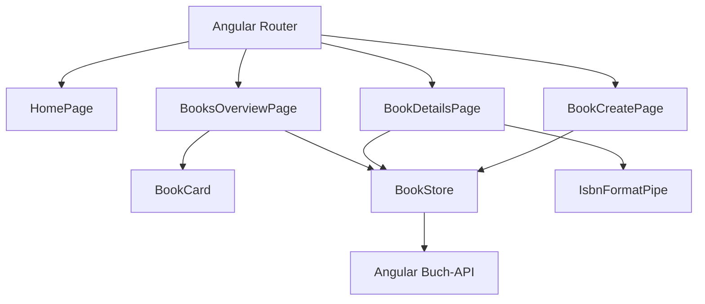

# BookManager

Abgeschlossenes Angular-Schulprojekt auf Basis des Beispielprojekts aus dem Fachbuch [*Angular – Das Praxisbuch*](https://angular-buch.com/) (Ferdinand Malcher, Danny Koppenhagen, Johannes Hoppe; umgesetzt bis Seite 363) für eine Buchübersicht, Detailansicht und Bucherstellung. Die Anwendung verwendet Angular 22.2, TypeScript, Signals, `httpResource`, Signal Forms (`@angular/forms/signals`), Vitest und die externe Buch-API `https://api1.angular-buch.com`.

## Inhaltsverzeichnis

- [Funktionen](#funktionen)
- [Routen und Abläufe](#routen-und-abläufe)
- [Technik und Daten](#technik-und-daten)
- [Validierung und Grenzen](#validierung-und-grenzen)
- [Lokale Ausführung](#lokale-ausführung)
- [Build und Tests](#build-und-tests)
- [Projektstruktur](#projektstruktur)
- [Architektur](#architektur)

## Funktionen

- Startseite (`/home`) mit Navigation zur Bücherübersicht und Buchverwaltung
- Bücherübersicht (`/books`) mit lokaler Titelsuche ohne Beachtung der Groß- und Kleinschreibung und einer Schaltfläche zum erneuten Laden (`Reload` mit `aria-busy`-Zustand)
- Favoritenliste im Signal-Zustand der Übersichtsseite; doppelte ISBNs werden dedupliziert, die Liste kann vollständig geleert werden
- ISBN-basierte Detailseite (`/books/details/:isbn`) mit Titel, optionalem Untertitel, Autoren, formatierter ISBN (`IsbnFormatPipe`), Erstellungsdatum (`DatePipe`), Beschreibung und Cover
- Löschaktion auf der Detailseite mit Bestätigungsdialog (`confirm`) und anschließender Rückkehr zur Bücherübersicht
- Barrierefreies Formular zum Erstellen eines Buchs (`/admin/create`) auf Basis von Angular Signal Forms mit dynamisch ergänzbaren Autorenfeldern, Feldvalidierung und ARIA-Fehlerattributen (`aria-invalid`, `aria-errormessage`)

Favoriten werden nicht dauerhaft gespeichert und stehen nur im aktuellen Lauf der Anwendung zur Verfügung. Buchdaten und Schreiboperationen laufen über die externe API; die entsprechenden Funktionen benötigen eine erreichbare API.

## Routen und Abläufe

| Route | Zweck |
| --- | --- |
| `/` | Leitet auf `/home` weiter. |
| `/home` | Startseite der Anwendung (`HomePage`). |
| `/books` | Lädt Bücher, filtert nach Titel, zeigt Buchkarten und Favoriten (`BooksOverviewPage`). |
| `/books/details/:isbn` | Lädt ein einzelnes Buch anhand der ISBN und zeigt Details sowie Löschaktion (`BookDetailsPage`). |
| `/admin` | Leitet auf `/admin/create` weiter. |
| `/admin/create` | Validiert und sendet ein neues Buch (`BookCreatePage`). Nach erfolgreichem Speichern öffnet sich dessen Detailseite. |

Die Suche wird lokal auf den geladenen Buchtiteln ausgeführt. „Reload“ fordert die Bücherliste erneut an. Auf der Detailseite zeigt die Ansicht Lade- und Fehlerzustände; vor dem Löschen muss der Dialog bestätigt werden.

## Technik und Daten

- Angular 22.2 und Angular Router mit eigenständigen Seitenkomponenten und `withComponentInputBinding()`
- Angular Signals (`signal`, `computed`) und `httpResource` für reaktive Datenansichten
- Angular Signal Forms (`form`, `FormRoot`, `FormField`, `required`, `minLength`, `maxLength`, `validate`) für die Formularvalidierung
- Benutzerdefinierte `IsbnFormatPipe` zur Formatierung 13-stelliger ISBNs (z. B. `978-1-2345-6789-0`)
- RxJS (`Observable`, `firstValueFrom`) und `HttpClient` für API-Aufrufe
- Vitest und `@angular/core/testing` (`TestBed`, `RouterTestingHarness`, `HttpTestingController`) für Unit-Tests

Der `BookStore` kapselt die API `https://api1.angular-buch.com` und verwendet folgende Endpunkte:

| Methode | Endpunkt | Verwendung |
| --- | --- | --- |
| `GET` | `/books` | Bücherübersicht (`httpResource`) |
| `GET` | `/books/{isbn}` | Buchdetails (`httpResource`) |
| `POST` | `/books` | Neues Buch anlegen (`Promise<Book>`) |
| `DELETE` | `/books/{isbn}` | Buch löschen (`Observable<void>`) |

Das Buchmodell (`Book`) enthält `isbn`, `title`, optionale `subtitle`, `authors`, `description`, `imageUrl` und `createdAt`. Beim Erstellen setzt die Anwendung `createdAt` auf den aktuellen ISO-Zeitstempel.

## Validierung und Grenzen

- Titel, ISBN, Beschreibung und Cover-URL sind Pflichtfelder (`required`).
- Die ISBN muss genau 13 Zeichen lang sein (`minLength` / `maxLength`). Eine ISBN-Prüfziffer wird nicht validiert.
- Mindestens ein Autorenfeld muss ausgefüllt sein (`atLeastOneAuthor`); leere zusätzliche Felder werden vor dem Speichern herausgefiltert.
- Erst nach Berühren eines Feldes (`touched`) werden Fehlermeldungen sowie `aria-invalid` und `aria-errormessage` gesetzt.
- Die Favoriten sind nur im Speicher der Übersichtsseite gehalten. Eine Speicherung in Browser oder API gibt es nicht.
- Die Datenansichten hängen von der externen Buch-API ab. Auf der Detailansicht wird bei einem fehlgeschlagenen Abruf eine Fehlermeldung (`role="alert"`) angezeigt.

## Lokale Ausführung

Node.js und npm werden benötigt. Installiere die Abhängigkeiten und starte den Entwicklungsserver im Projektordner:

```bash
npm install
npm start
```

Die Entwicklungsanwendung ist standardmäßig unter `http://localhost:4200/` erreichbar. Der Server lädt Änderungen während der Entwicklung automatisch nach.

## Build und Tests

```bash
npm run build
npm test
```

Der Produktionsbuild wird im Angular-Ausgabeverzeichnis `dist/` erstellt.

Die vorhandenen Vitest-Spezifikationen (`*.spec.ts`) liegen direkt neben den Komponenten, Pipes und Services:

- `book-store.spec.ts` – Prüft `getAll()`, `getSingle()`, `remove()` sowie die Behandlung von HTTP-500-Serverfehlern mit `HttpTestingController`.
- `books-overview-page.spec.ts` – Prüft das Rendern der Buchkarten, die case-insensitive Titelfilterung und das Routing auf `/books`.
- `book-details-page.spec.ts` – Prüft das Laden eines Buchs per ISBN-Input-Binding, Reaktivität bei ISBN-Wechsel und die Detail-Navigation.
- `book-create-page.spec.ts` – Prüft das Hinzufügen weiterer Autorenfelder, Formular-Submit mit Zeitstempel, Herausfiltern leerer Autoren, ISBN-Validierung (`required`, `minLength`, `maxLength`), ARIA-Fehlerattribute und die Weiterleitung zur Detailseite.
- `book-card.spec.ts` – Prüft Titel-, ISBN- und Bilddarstellung sowie das Auslösen des `like`-Events.
- `isbn-format.pipe.spec.ts` – Prüft die Formatierung 13-stelliger ISBNs und unveränderte Rückgabe kürzerer Strings.
- `home-page.spec.ts`, `main-area.spec.ts`, `app.spec.ts` – Prüfen die Erstellung der Basis-Komponenten und die `/home`-Route.

## Projektstruktur

```text
src/app/
├── app.*                      # Root-Komponente, Navigation, Routen und Spec
├── home-page/                 # Startseite (/home) und Spec
├── main-area/                 # MainArea-Komponente und Spec
├── books-portal/
│   ├── books-portal.routes.ts # Portal-Routen (/books, /books/details/:isbn)
│   ├── books-overview-page/   # Suche, Bücherliste, Favoriten und Spec
│   ├── book-card/             # Buchkarte und Spec
│   └── book-details-page/     # Details, Löschen und Spec
├── books-admin/
│   ├── books-admin.routes.ts  # Admin-Routen (/admin, /admin/create)
│   └── book-create-page/      # Signal-Forms-Erstellung, Validierung und Spec
└── shared/                    # Book-Modell, BookStore, IsbnFormatPipe und Specs
```

## Architektur



Die Routen sind in Home-, Portal- und Admin-Routen gegliedert. Suchbegriff und Favoriten hält die Übersichtsseite als Signals:

```ts
protected searchTerm = signal('');
protected likedBooks = signal<Book[]>([]);
```

Weitere Angular-Übungen stehen in der [Übersicht Angular_Practice](../README.md).
