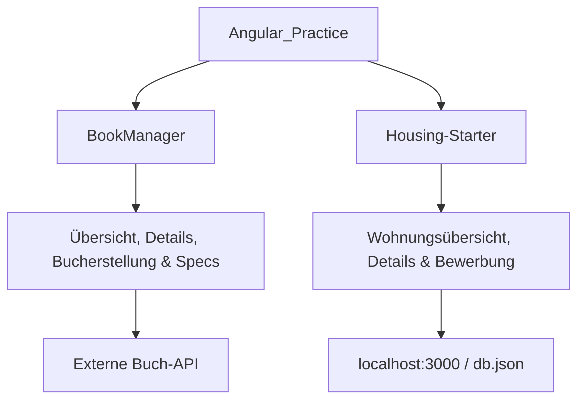

# Angular Practice

Dieser Bereich bündelt die abgeschlossenen Angular-Lernprojekte des Repositories. Jedes Projekt hat eigene Abhängigkeiten und wird direkt in seinem Projektordner gestartet.

## Inhaltsverzeichnis

- [Projekte](#projekte)
- [Voraussetzungen](#voraussetzungen)
- [Architektur](#architektur)

## Projekte

### BookManager

[BookManager](./BookManager/README.md) ist das Beispielprojekt aus dem Fachbuch [*Angular – Das Praxisbuch*](https://angular-buch.com/) (Ferdinand Malcher, Danny Koppenhagen, Johannes Hoppe), vollständig bis zum geplanten Unterrichtsende (Seite 363) als Angular-22.2-Anwendung umgesetzt. Sie enthält eine Übersicht mit Titelsuche und Favoriten im Sitzungsspeicher, eine ISBN-basierte Detailseite mit ISBN-Formatierung (`IsbnFormatPipe`) und Löschaktion sowie ein barrierefreies Signal-Forms-Formular zum Anlegen neuer Bücher. Lese- und Schreibzugriffe laufen über die externe Buch-API `https://api1.angular-buch.com`; Komponenten, Pipes und der `BookStore` sind mit Vitest-Spezifikationen abgedeckt.

Start im Projektordner:

```bash
cd Angular_Practice/BookManager
npm install
npm start
```

### Housing-Starter

[punynobm--run](./punynobm--run/README.md) basiert auf dem offiziellen Einsteiger-Tutorial von [angular.dev ("First App")](https://angular.dev/tutorials/first-app) mit Wohnungsübersicht und Stadtsuche. Eine Detailseite zeigt Ausstattung sowie freie Einheiten und enthält ein Bewerbungsformular. Die Angebotsdaten werden über `http://localhost:3000/locations` geladen (passende Mock-Daten liegen in [`../db.json`](../db.json) im Repository-Root).

Start im Projektordner:

```bash
cd Angular_Practice/punynobm--run
npm install
npm start
```

## Voraussetzungen

Beide Projekte benötigen Node.js und npm. Abhängigkeiten werden je Projekt installiert; die Angular-Projekte verwenden nicht die npm-Abhängigkeiten im Repository-Root. BookManager nutzt Angular 22.2 und TypeScript ~6.0, Housing-Starter eine Angular-22.2-Vorschauversion.

## Architektur


