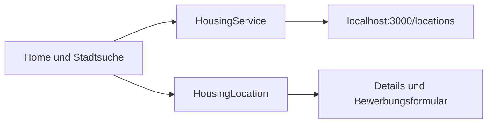

# Housing-Starter

Dieses Angular-Lernprojekt basiert auf dem offiziellen Einsteiger-Tutorial von [angular.dev ("Your first Angular app")](https://angular.dev/tutorials/first-app) und zeigt Wohnungsangebote mit Stadtsuche, Detailansicht und Bewerbungsformular. Es verwendet eine Angular-22.2-Vorschauversion und ist unabhängig vom BookManager.

## Inhaltsverzeichnis

- [Funktionen](#funktionen)
- [Lokale Ausführung](#lokale-ausführung)
- [Projektstruktur](#projektstruktur)
- [Architektur](#architektur)

## Funktionen

- Wohnungsangebote als Liste anzeigen (`Home`)
- Ergebnisse anhand des Städtenamens ohne Beachtung der Groß- und Kleinschreibung filtern
- Daten asynchron über den `HousingService` von `http://localhost:3000/locations` laden
- Detailseite (`/details/:id`) mit Foto, Standort, Ausstattung (WLAN, Waschmöglichkeit) und verfügbaren Einheiten anzeigen
- Bewerbungsformular (`ReactiveFormsModule`) mit Vorname, Nachname und E-Mail absenden (Ausgabe der Formulardaten erfolgt in der Browser-Konsole)

## Lokale Ausführung

Node.js und npm werden benötigt. Im Projektordner:

```bash
cd Angular_Practice/punynobm--run
npm install
npm start
```

Für die Wohnungsdaten erwartet `HousingService` einen lokalen Endpunkt unter `http://localhost:3000/locations`. Im Repository-Root liegt dafür die Beispieldatei [`../../db.json`](../../db.json), die beispielsweise mit `json-server` bereitgestellt werden kann:

```bash
npx json-server db.json
```

Die Angular-Entwicklungsserver-URL ist standardmäßig `http://localhost:4200/`; Details sind über `/details/:id` erreichbar.

## Projektstruktur

- `src/app/home/` – Startansicht, Stadtsuche und Angebotsliste
- `src/app/housing-location/` – Karten-Komponente für ein einzelnes Wohnungsangebot
- `src/app/details/` – Angebotsdetails und reaktives Bewerbungsformular
- `src/app/routes.ts` – Start- und Detailrouten (`/` und `/details/:id`)
- `src/app/housing.service.ts` – Datenzugriff über `fetch('http://localhost:3000/locations')` und Konsolenausgabe der Bewerbung
- `src/app/housinglocation.ts` – Interface `HousingLocationInfo`

## Architektur



Der Filter vergleicht den Suchtext ohne Beachtung der Groß- und Kleinschreibung:

```ts
location.city.toLowerCase().includes(text.toLowerCase())
```

Zur übergeordneten Projektliste: [Angular Practice](../README.md).
