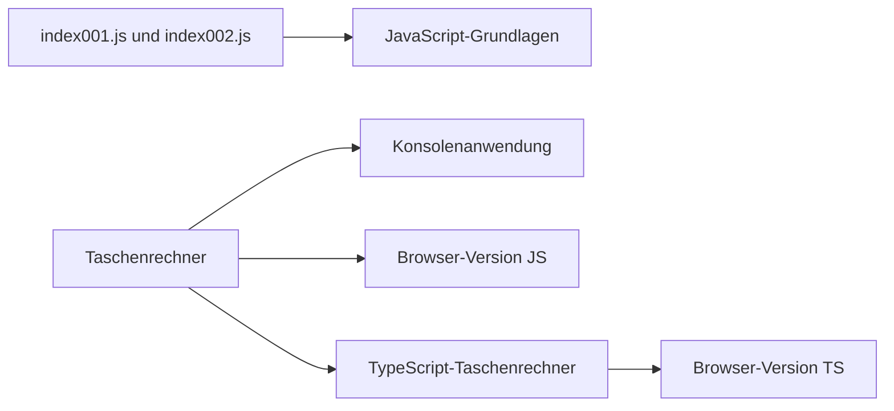

# JavaScript-Übungen

Dieser Ordner enthält kleine JavaScript-Übungen und Lernbeispiele für die Einführung in die Programmierung mit Node.js und im Browser.

## Inhaltsverzeichnis

- [Hinweis](#hinweis--disclaimer)
- [Inhalte](#inhalte)
- [Taschenrechner](#taschenrechner)
- [TypeScript-Taschenrechner](#typescript-taschenrechner)
- [Aufbau](#aufbau)

## Hinweis / Disclaimer

> Dieses Material ist ein Lernprojekt zur Programmierung mit JavaScript. Es dient ausschließlich für Übungs- und Schulzwecke. Es wird ohne Gewährleistung bereitgestellt.

## Inhalte

- `index001.js` – erste JavaScript-Einführung
- `index002.js` – weitere grundlegende Anwendungsbeispiele
- [`Taschenrechner/`](./Taschenrechner/README.md) – JavaScript-Taschenrechner für Konsole (`index.js`, `Taschenrechner.js`) und Browser (`index.html`, `Taschenrechner ONLINE.js`) mit Eingabe- und Validierungslogik; [Planung und Programmzeichnung](./Taschenrechner/Plannung/) liegen im Unterordner `Plannung/`
- [`../Typescript intro/Taschenrechner - Typescript/`](../Typescript%20intro/Taschenrechner%20-%20Typescript/README.md) – TypeScript-Version für Konsole und Browser

## Taschenrechner

Der Taschenrechner verarbeitet komplette Rechenausdrücke (mit Punkt-vor-Strich-Regel) sowohl in der Konsole als auch im Browser:

```txt
10+2*3
5-2+4
```

Starten in der Konsole:

```bash
cd "Javascript intro/Taschenrechner"
node index.js
```

Oder im Repository-Root:

```bash
npm start
```

Die Browser-Version kann direkt über [`Taschenrechner/index.html`](./Taschenrechner/index.html) geöffnet werden.

## TypeScript-Taschenrechner

Die TypeScript-Version wird vor dem Start kompiliert und enthält ebenfalls eine Browser-Version für GitHub Pages:

```bash
npm run build:typescript
npm run start:typescript
```

Die Browser-Seite befindet sich in [`../Typescript intro/Taschenrechner - Typescript/index.html`](../Typescript%20intro/Taschenrechner%20-%20Typescript/index.html).

## Aufbau



Ein typischer Konsolenaufruf:

```text
Berechnung > 10+2*3
Ergebnis: 16
```
