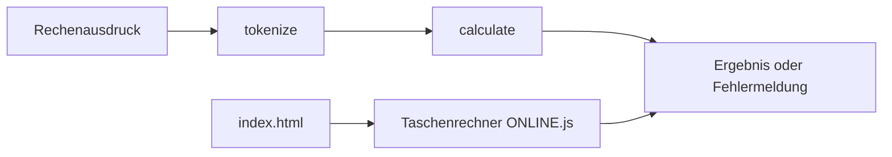

# Kleiner Taschenrechner (JavaScript)

## Inhaltsverzeichnis

- [Überblick](#überblick)
- [Hinweis / Disclaimer](#hinweis--disclaimer)
- [Funktionsumfang](#funktionsumfang)
- [Lokale Ausführung](#lokale-ausführung)
- [Beispiel](#beispiel)
- [Online-Version](#online-version)
- [Wichtige Dateien](#wichtige-dateien)
- [Aufbau](#aufbau)

## Überblick

Dieses Projekt ist ein kleiner JavaScript-Taschenrechner für grundlegende Rechenoperationen. Die Online-Version läuft direkt im Browser und kann über GitHub Pages geöffnet werden. Die Eingabe erfolgt als kompletter Rechenausdruck, zum Beispiel:

```txt
10+2*3
5-2+4
```

Die App prüft, ob die Eingabe gültig ist, und berechnet das Ergebnis direkt auf der Webseite oder in der Konsole.

## Hinweis / Disclaimer

> Dieses Projekt dient ausschließlich als Lern- und Übungsprojekt. Es wird ohne Gewährleistung bereitgestellt. Für produktive, kommerzielle oder kritische Anwendungen ist es nicht vorgesehen.

## Funktionsumfang

- Eingabe einer kompletten Berechnung in der Konsole oder im Browser
- Entfernen von Leerzeichen
- Validierung der Reihenfolge von Zahlen und Operatoren
- Unterstützung für `+`, `-`, `*`, `/` (inkl. Dezimalzahlen und Vorzeichen)
- Korrekte Priorität: `*` und `/` vor `+` und `-` (Punkt vor Strich)
- Fehlerbehandlung bei ungültiger Eingabe oder Division durch null
- Bedienung im Browser über eine statische HTML-Seite mit Sprachumschaltung (Deutsch/Englisch)

## Lokale Ausführung

1. In das Repository-Verzeichnis wechseln:

   ```bash
   cd /pfad/zu/BITLC-Angular
   ```

2. Abhängigkeiten installieren:

   ```bash
   npm install
   ```

3. Die Konsolenversion starten:

   ```bash
   npm start
   ```

   Oder direkt im Taschenrechner-Ordner:

   ```bash
   cd "Javascript intro/Taschenrechner"
   node index.js
   ```

4. Eine Rechnung eingeben, z. B.:

   ```txt
   12+4*2
   ```

5. Mit `exit` oder `Strg+C` beenden.

## Beispiel

```txt
Berechnung > 12+4*2
Ergebnis: 20

Berechnung > 10/0
Fehler: Division durch 0 ist nicht erlaubt.
```

## Online-Version

Die Browser-Version liegt in [`index.html`](./index.html) und [`Taschenrechner ONLINE.js`](./Taschenrechner%20ONLINE.js) und bindet die gemeinsame Sprachauswahl ([`../../language.js`](../../language.js), [`../../de.lang`](../../de.lang), [`../../en.lang`](../../en.lang)) ein. Beide Dateien werden von GitHub Pages direkt als statische Dateien ausgeliefert:

<https://j-moessmer.github.io/BITLC-Angular/Javascript%20intro/Taschenrechner/>

## Wichtige Dateien

- `Taschenrechner.js` – Kernlogik zur Tokenisierung und Berechnung (Konsole)
- `Taschenrechner ONLINE.js` – Browser-Logik für GitHub Pages
- `index.html` – Webseite der Browser-Version
- `index.js` – Einstiegspunkt für die Konsole
- [Planungsdokument](./Plannung/Programmplannung.md) – Aufgabenbeschreibung und Planung
- [Programmzeichnung](./Plannung/programplanzeichnung.png)

## Aufbau



Beispiel für die Eingabe und Ausgabe:

```text
Berechnung > 12+4*2
Ergebnis: 20
```
