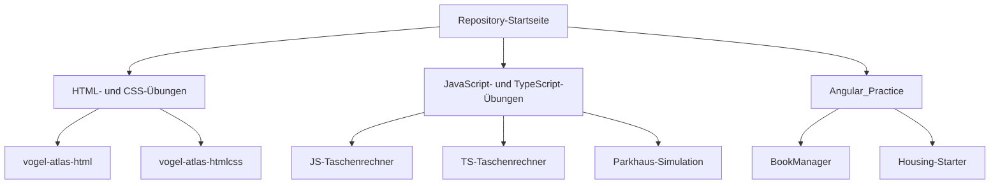

# BITLC Projects

Dieses Repository sammelt meine abgeschlossenen Schulübungen zur Webentwicklung sowie zu JavaScript-, TypeScript- und Angular-Grundlagen. Die Projekte bauen aufeinander auf und zeigen den Lernweg von einer ersten reinen HTML5-Webseite über die Gestaltung mit CSS und Skriptsprachen bis hin zu vollständigen Angular-22-Anwendungen.

## Inhaltsverzeichnis

- [Hinweis](#hinweis--disclaimer)
- [Live ansehen](#live-ansehen)
- [Startseite](#startseite)
- [Sprachauswahl](#sprachauswahl)
- [Projekte](#projekte)
- [Repository-Struktur](#repository-struktur)
- [Lokale Ausführung](#lokale-ausführung)
- [Direkte Projektlinks](#direkte-projektlinks)
- [Projektübersicht](#projektübersicht)

## Hinweis / Disclaimer

> Dieses Repository ist ein Lernprojekt und dient dem Üben von HTML-, CSS-, JavaScript-, TypeScript- und Angular-Grundlagen. Es wird ohne Gewährleistung bereitgestellt. Fehler, Unvollständigkeiten oder technische Einschränkungen können vorkommen. Für produktiven Einsatz oder kommerzielle Nutzung ist keine Garantie oder Supportleistung vorgesehen.

## Live ansehen

**GitHub Pages:** <https://j-moessmer.github.io/BITLC-Angular/>

## Startseite

Die zentrale Projektübersicht befindet sich in der [Haupt-Landingpage](./index.html). Von dort aus können die im Browser ausführbaren Übungen direkt geöffnet werden.

## Sprachauswahl

Die Projektübersicht und alle CSS-gestalteten Browserprojekte bieten Deutsch und Englisch. Die Auswahl wird zwischen den Seiten gespeichert; Übersetzungen und gemeinsame Sprachsteuerung liegen in [`de.lang`](./de.lang), [`en.lang`](./en.lang), [`language.js`](./language.js) und [`language.css`](./language.css). Der reine HTML-VogelAtlas bleibt unverändert auf Deutsch.

## Projekte

### 1. VogelFinder – HTML5

- **Ordner:** [vogel-atlas-html](./vogel-atlas-html/)
- **Dokumentation:** [vogel-atlas-html/README.md](./vogel-atlas-html/README.md)
- **Startseite:** [vogel-atlas-html/index.html](./vogel-atlas-html/index.html)
- **Beschreibung:** Erste Schulübung: eine mehrseitige Webseite mit reinem HTML5 (Zero-CSS / Zero-JS).
- **Schwerpunkte:** semantische HTML-Struktur, interne Verlinkungen, Tabellen, Formulare und eine interaktive SVG-Deutschlandkarte.

### 2. VogelFinder – HTML + CSS

- **Ordner:** [vogel-atlas-htmlcss](./vogel-atlas-htmlcss/)
- **Dokumentation:** [vogel-atlas-htmlcss/README.md](./vogel-atlas-htmlcss/README.md)
- **Startseite:** [vogel-atlas-htmlcss/index.html](./vogel-atlas-htmlcss/index.html)
- **Beschreibung:** Weiterentwicklung des VogelFinders mit einem gemeinsamen CSS-Stylesheet und Sprachauswahl.
- **Schwerpunkte:** Farben, Abstände, Typografie, responsive Darstellung, Kartenlayout und eine nicht überlappende Navigation.

### 3. JavaScript Grundlagen – Taschenrechner

- **Ordner:** [Javascript intro/Taschenrechner](./Javascript%20intro/Taschenrechner/)
- **Dokumentation:** [Javascript intro/Taschenrechner/README.md](./Javascript%20intro/Taschenrechner/README.md)
- **Startdatei (Konsole):** [Javascript intro/Taschenrechner/index.js](./Javascript%20intro/Taschenrechner/index.js)
- **Browserseite:** [Javascript intro/Taschenrechner/index.html](./Javascript%20intro/Taschenrechner/index.html)
- **Beschreibung:** Konsolen- und browserbasierter Taschenrechner mit Eingabevalidierung und Operator-Priorität.
- **Schwerpunkte:** Tokenisierung, Fehlererkennung, Punkt-vor-Strich-Berechnung, Eingabe-Schleife und statische Browseroberfläche.

### 4. TypeScript – Taschenrechner

- **Ordner:** [Typescript intro/Taschenrechner - Typescript](./Typescript%20intro/Taschenrechner%20-%20Typescript/)
- **Dokumentation:** [Typescript intro/Taschenrechner - Typescript/README.md](./Typescript%20intro/Taschenrechner%20-%20Typescript/README.md)
- **Browserseite:** [Typescript intro/Taschenrechner - Typescript/index.html](./Typescript%20intro/Taschenrechner%20-%20Typescript/index.html)
- **Beschreibung:** TypeScript-Version des Taschenrechners mit Konsolen- und Browserausgabe.
- **Schwerpunkte:** Union-Typen, strikte Typprüfung, Node.js- und DOM-Konfiguration sowie Kompilierung für GitHub Pages.

### 5. TypeScript – Parkhaus-Simulation

- **Ordner:** [Typescript intro/Parkhaus](./Typescript%20intro/Parkhaus/)
- **Dokumentation:** [Typescript intro/Parkhaus/README.md](./Typescript%20intro/Parkhaus/README.md)
- **Terminaldatei:** [Typescript intro/Parkhaus/Parkhaus.ts](./Typescript%20intro/Parkhaus/Parkhaus.ts)
- **Browserseite:** [Parkhaus online](./Typescript%20intro/Parkhaus/index.html)
- **Beschreibung:** Interaktive Parkhaus-Simulation (Terminal- und Browserversion) mit Minuten-Ticks, Live-Belegung, Entlastungsregel, manuellen Aktionen und Tagesabrechnung.
- **Live ansehen:** <https://j-moessmer.github.io/BITLC-Angular/Typescript%20intro/Parkhaus/>

### 6. Angular-Lernprojekte

- **Übersicht:** [Angular_Practice/README.md](./Angular_Practice/README.md)
- **BookManager:** [Projektordner](./Angular_Practice/BookManager/) und [Dokumentation](./Angular_Practice/BookManager/README.md) – Das Beispielprojekt aus dem Fachbuch [*Angular – Das Praxisbuch*](https://angular-buch.com/) (umgesetzt bis S. 363) mit Buchsuche, Favoriten, ISBN-Formatierung, Detailansicht, Löschfunktion, Signal-Forms-Erstellformular und Vitest-Unit-Tests.
- **Housing-Starter:** [Projektordner](./Angular_Practice/punynobm--run/) und [Dokumentation](./Angular_Practice/punynobm--run/README.md) – Das Einsteiger-Tutorialprojekt von [angular.dev ("First App")](https://angular.dev/tutorials/first-app) mit Wohnungsübersicht, Stadtsuche, Detailseite, Bewerbungsformular und lokaler JSON-Datenbasis ([`db.json`](./db.json)).
- **Technik:** Beide Apps verwenden Angular 22 und TypeScript mit eigenen Abhängigkeiten und Startbefehlen. BookManager nutzt Angular 22.2; Housing-Starter basiert auf einer Angular-22.2-Vorschauversion.

## Repository-Struktur

```text
BITLC-Angular/
├── .agents/                       # KI-Richtlinien, Kontext und Arbeitsplan
├── .vscode/
├── index.html                     # Zentrale Landingpage
├── de.lang / en.lang              # Gemeinsame Übersetzungen
├── language.js / language.css     # Gemeinsame Sprachauswahl
├── db.json                        # Lokale Mock-Daten für Housing-Starter
├── Javascript intro/              # JavaScript-Lernübungen
│   ├── README.md
│   ├── index001.js
│   ├── index002.js
│   └── Taschenrechner/
│       ├── README.md
│       ├── index.html
│       ├── index.js
│       ├── Taschenrechner.js
│       ├── Taschenrechner ONLINE.js
│       └── Plannung/
│           ├── Programmplannung.md
│           └── programplanzeichnung.png
├── Typescript intro/              # TypeScript-Lernübungen
│   ├── Parkhaus/
│   │   ├── README.md
│   │   ├── index.html
│   │   ├── Parkhaus.ts
│   │   ├── Parkhaus ONLINE.ts
│   │   ├── Parkhaus ONLINE.js
│   │   ├── tsconfig.json
│   │   ├── tsconfig.browser.json
│   │   └── Plannung/
│   │       ├── Projektplan.md
│   │       ├── Park-backend1.png
│   │       ├── Park-backend2.png
│   │       ├── Park-frontend1.png
│   │       ├── Park-frontend2.png
│   │       └── Park-frontend3.png
│   └── Taschenrechner - Typescript/
│       ├── README.md
│       ├── index.html
│       ├── index.ts
│       ├── Taschenrechner.ts
│       ├── Taschenrechner ONLINE.ts
│       ├── tsconfig.node.json
│       ├── tsconfig.browser.json
│       └── Plannung/
│           ├── Programmplannung.md
│           └── programplanzeichnung.png
├── Angular_Practice/              # Angular-Lernprojekte
│   ├── README.md
│   ├── BookManager/               # Buchportal, Signal Forms und Vitest-Specs
│   └── punynobm--run/             # Housing-Übungsprojekt
├── vogel-atlas-html/              # Übung mit reinem HTML5
│   ├── index.html
│   ├── template.html
│   └── README.md
├── vogel-atlas-htmlcss/           # HTML5-Übung mit CSS
│   ├── index.html
│   ├── styles.css
│   ├── template.html
│   └── README.md
├── README.md
├── package.json
├── LICENSE
└── .gitignore
```

## Lokale Ausführung

### HTML-Projekte

Die HTML- und Browserprojekte benötigen für die reine Ansicht keine Installation von Node.js oder npm:

1. Repository klonen:

   ```bash
   git clone https://github.com/J-Moessmer/BITLC-Angular.git
   cd BITLC-Angular
   ```

2. [index.html](./index.html) im Browser öffnen.
3. Ein Projekt über die Landingpage auswählen oder die jeweilige `index.html` direkt öffnen.

Alternativ kann die [Haupt-Landingpage](./index.html) in VS Code mit **Open with Live Server** gestartet werden.

### JavaScript-Taschenrechner

```bash
cd "Javascript intro/Taschenrechner"
node index.js
```

Oder aus dem Repository-Root:

```bash
npm start
```

### TypeScript-Taschenrechner

```bash
npm install
npm run build:typescript
npm run start:typescript
```

Die Browser-Version kann über [`Typescript intro/Taschenrechner - Typescript/index.html`](./Typescript%20intro/Taschenrechner%20-%20Typescript/index.html) geöffnet werden.

### TypeScript – Parkhaus-Simulation

Terminalversion starten:

```bash
npm install
cd "Typescript intro/Parkhaus"
npx ts-node Parkhaus.ts
```

Browserversion kompilieren:

```bash
npm run build:parkhaus
```

### Angular BookManager

Die Angular-Anwendung hat eine eigene Abhängigkeitsinstallation:

```bash
cd Angular_Practice/BookManager
npm install
npm start
```

Danach ist die Entwicklungsanwendung unter `http://localhost:4200/` erreichbar. Der lokale Build und die Unit-Tests starten mit `npm run build` und `npm test`.

### Angular Housing-Starter

```bash
cd Angular_Practice/punynobm--run
npm install
npm start
```

Die Wohnungsdaten werden von `http://localhost:3000/locations` geladen (Beispieldaten in [`db.json`](./db.json)).

## Direkte Projektlinks

- [Zentrale Landingpage](https://j-moessmer.github.io/BITLC-Angular/)
- [VogelFinder HTML5](https://j-moessmer.github.io/BITLC-Angular/vogel-atlas-html/)
- [VogelFinder HTML + CSS](https://j-moessmer.github.io/BITLC-Angular/vogel-atlas-htmlcss/)
- [JavaScript-Taschenrechner (Browser)](https://j-moessmer.github.io/BITLC-Angular/Javascript%20intro/Taschenrechner/)
- [TypeScript-Taschenrechner (Browser)](https://j-moessmer.github.io/BITLC-Angular/Typescript%20intro/Taschenrechner%20-%20Typescript/)
- [Parkhaus-Simulation (Browser)](https://j-moessmer.github.io/BITLC-Angular/Typescript%20intro/Parkhaus/)

## Projektübersicht


