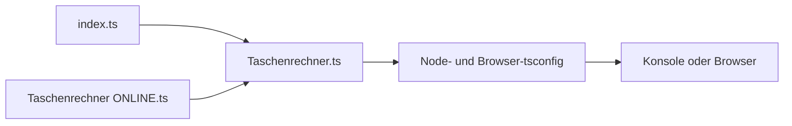

# Kleiner Taschenrechner (TypeScript)

## Inhaltsverzeichnis

- [Überblick](#überblick)
- [Hinweis / Disclaimer](#hinweis--disclaimer)
- [Funktionsumfang](#funktionsumfang)
- [Lokale Ausführung](#lokale-ausführung)
- [Beispiel](#beispiel)
- [Online-Version](#online-version)
- [Wichtige Dateien](#wichtige-dateien)
- [Aufbau](#aufbau)

## Überblick

Dieses Projekt ist ein kleiner TypeScript-Taschenrechner für grundlegende Rechenoperationen. TypeScript wird für die Konsolen- und Browser-Version kompiliert. Die Eingabe erfolgt als kompletter Rechenausdruck, zum Beispiel:

```txt
10+2*3
5-2+4
```

Die App prüft, ob die Eingabe gültig ist, und berechnet das Ergebnis entweder in der Konsole oder direkt auf der Webseite.

## Hinweis / Disclaimer

> Dieses Projekt dient ausschließlich als Lern- und Übungsprojekt. Es wird ohne Gewährleistung bereitgestellt. Für produktive, kommerzielle oder kritische Anwendungen ist es nicht vorgesehen.

## Funktionsumfang

- Eingabe einer kompletten Berechnung in Konsole oder Browser
- Entfernen von Leerzeichen
- Validierung der Reihenfolge von Zahlen und Operatoren
- Unterstützung für `+`, `-`, `*`, `/`
- Korrekte Priorität: `*` und `/` vor `+` und `-` (Punkt vor Strich)
- Fehlerbehandlung bei ungültiger Eingabe oder Division durch null
- Bedienung über eine statische HTML-Seite mit Sprachumschaltung (Deutsch/Englisch)
- Strikte Typprüfung und getrennte Kompilierung für Node.js und Browser mit TypeScript

## Lokale Ausführung

1. In das Repository-Verzeichnis wechseln:

   ```bash
   cd /pfad/zu/BITLC-Angular
   ```

2. Abhängigkeiten installieren:

   ```bash
   npm install
   ```

3. TypeScript kompilieren und die Konsolenversion starten:

   ```bash
   npm run start:typescript
   ```

   Nur kompilieren:

   ```bash
   npm run build:typescript
   ```

4. Eine Rechnung eingeben, z. B.:

   ```txt
   12+4*2
   ```

5. Mit `exit` oder `Strg+C` beenden.

## Beispiel

```txt
Berechnung > 12+4*2
Ergebnis: 20

Berechnung > 10/0
Fehler: Division durch 0 ist nicht erlaubt.
```

## Online-Version

Nach `npm run build:typescript` liegen die kompilierten Browser-Dateien in diesem Ordner. Die [`index.html`](./index.html) lädt die kompilierte `Taschenrechner ONLINE.js` sowie die gemeinsame Sprachsteuerung (`../../language.js`, `../../de.lang`, `../../en.lang`) und kann direkt über GitHub Pages geöffnet werden:

<https://j-moessmer.github.io/BITLC-Angular/Typescript%20intro/Taschenrechner%20-%20Typescript/>

## Wichtige Dateien

- `Taschenrechner.ts` / `Taschenrechner.js` – Kernlogik zur Tokenisierung und Berechnung
- `Taschenrechner ONLINE.ts` / `Taschenrechner ONLINE.js` – Browser-Version für GitHub Pages
- `index.html` – Webseite der Browser-Version
- `index.ts` / `index.js` – Einstiegspunkt für die Konsole
- `tsconfig.node.json` – TypeScript-Konfiguration für Node.js
- `tsconfig.browser.json` – TypeScript-Konfiguration für den Browser
- [Planungsdokument](./Plannung/Programmplannung.md) – Aufgabenbeschreibung und Planung
- [Programmzeichnung](./Plannung/programplanzeichnung.png)

## Aufbau



Beispiel für eine gültige Rechnung:

```text
Berechnung > 12+4*2
Ergebnis: 20
```
