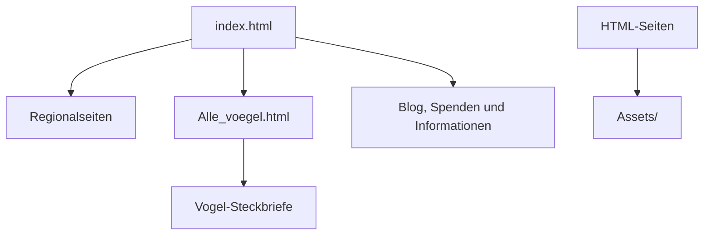

# VogelFinder – HTML5-Übung

## Inhaltsverzeichnis

- [Startseite](#startseite)
- [Inhalte](#inhalte)
- [Technik](#technik)
- [Lokale Ausführung](#lokale-ausführung)
- [Seitenstruktur](#seitenstruktur)
- [Online](#online)
- [Aufbau](#aufbau)

Der VogelFinder ist meine erste Schulübung: eine mehrseitige Webseite, die ausschließlich mit HTML5 erstellt wurde. Die Seite stellt Vogelarten, Regionen und weiterführende Inhalte des Vogel Atlas Deutschland vor.

## Startseite

Die Website startet mit [index.html](./index.html). Die zentrale [Projekt-Landingpage](../index.html) verlinkt ebenfalls auf diese Version.

## Inhalte

- Interaktive SVG-Deutschlandkarte mit vier Regionen
- Übersicht mit acht Vogelarten und einzelnen Steckbriefen
- Seiten für Nord-, West-, Ost- und Süddeutschland
- Blog, Spendenseite, weiterführende Links sowie Impressum und Datenschutz
- Einheitlicher Header, Breadcrumb-Navigation, Sidebar und Footer auf Basis von [template.html](./template.html)

## Technik

- HTML5
- Inline-SVG
- Tabellen, Formulare und semantische Elemente
- Bild- und GIF-Assets
- Kein CSS und kein JavaScript

## Lokale Ausführung

Öffne [index.html](./index.html) direkt im Browser oder starte sie in VS Code mit **Open with Live Server**.

## Seitenstruktur

```text
vogel-atlas-html/
├── Assets/                       # 12 Bilder und Medien
├── index.html                    # Startseite mit Vogelkarte
├── Alle_voegel.html              # Übersicht aller Vogelarten
├── Vogel_*.html                  # 8 Vogel-Steckbriefe
├── Gebiet_*.html                 # 4 Regionale Übersichten
├── Blog.html                     # Blog
├── Spenden.html                  # Spendenseite
├── Siehe Auch.html               # Weiterführende Links
├── Datenschutzimpressum.html     # Impressum und Datenschutz
├── template.html                 # Wiederverwendbare Seitenvorlage
└── README.md                     # Unterprojekt-Dokumentation
```

## Online

<https://j-moessmer.github.io/BITLC-Angular/vogel-atlas-html/>

## Aufbau



Die Seiten verwenden native HTML-Strukturen, zum Beispiel:

```html
<main>
  <section aria-labelledby="birds-heading">
    <h2 id="birds-heading">Alle Vögel</h2>
  </section>
</main>
```
