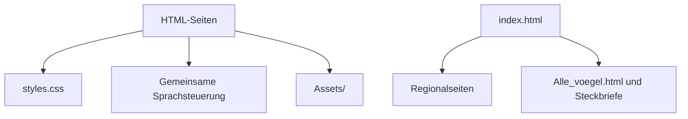

# VogelFinder – HTML + CSS-Übung

## Inhaltsverzeichnis

- [Startseite](#startseite)
- [Änderungen gegenüber der HTML5-Version](#änderungen-gegenüber-der-html5-version)
- [Inhalte](#inhalte)
- [Technik](#technik)
- [Lokale Ausführung](#lokale-ausführung)
- [Seitenstruktur](#seitenstruktur)
- [Online](#online)
- [Aufbau](#aufbau)

Diese Version ist die Weiterentwicklung meiner ersten VogelFinder-Übung. Die HTML5-Seiten wurden um ein gemeinsames Stylesheet ergänzt, damit die Website übersichtlicher und responsiv gestaltet ist.

## Startseite

Die Website startet mit [index.html](./index.html). Die zentrale [Projekt-Landingpage](../index.html) verlinkt auf diese HTML+CSS-Version.

## Änderungen gegenüber der HTML5-Version

- Gemeinsames Stylesheet [styles.css](./styles.css) für alle Seiten
- Einheitliche Farben, Typografie, Abstände und Karten
- Responsive Darstellung für kleinere Bildschirme
- Verbesserte Darstellung von Header, Footer, Formularen und Bildern
- Vertikale Navigationsseitenleiste mit ausreichendem Abstand
- Hover- und Fokuszustände für Links, Buttons und die SVG-Karte
- Einbindung der gemeinsamen Sprachauswahl (Deutsch/Englisch)

## Inhalte

Die Inhalte entsprechen der HTML5-Version:

- Interaktive SVG-Deutschlandkarte mit vier Regionen
- Übersicht mit acht Vogelarten und einzelnen Steckbriefen
- Regionale Übersichten, Blog, Spenden, weiterführende Links sowie Impressum und Datenschutz

## Technik

- HTML5
- CSS3 ([styles.css](./styles.css))
- Inline-SVG
- Bild- und GIF-Assets
- Gemeinsame Sprachumschaltung (`../language.js`, `../language.css`, `../de.lang`, `../en.lang`)

## Lokale Ausführung

Öffne [index.html](./index.html) direkt im Browser oder starte sie in VS Code mit **Open with Live Server**. Die Datei [styles.css](./styles.css) wird von allen HTML-Seiten automatisch eingebunden.

## Seitenstruktur

```text
vogel-atlas-htmlcss/
├── Assets/                       # 12 Bilder und Medien
├── index.html                    # Startseite mit Vogelkarte
├── styles.css                    # Gemeinsame Gestaltung
├── Alle_voegel.html              # Übersicht aller Vogelarten
├── Vogel_*.html                  # 8 Vogel-Steckbriefe
├── Gebiet_*.html                 # 4 Regionale Übersichten
├── Blog.html                     # Blog
├── Spenden.html                  # Spendenseite
├── Siehe Auch.html               # Weiterführende Links
├── Datenschutzimpressum.html     # Impressum und Datenschutz
├── template.html                 # Wiederverwendbare Seitenvorlage
└── README.md                     # Unterprojekt-Dokumentation
```

## Online

<https://j-moessmer.github.io/BITLC-Angular/vogel-atlas-htmlcss/>

## Aufbau



Die Gestaltung wird über das gemeinsame Stylesheet eingebunden:

```html
<link rel="stylesheet" href="styles.css">
```
